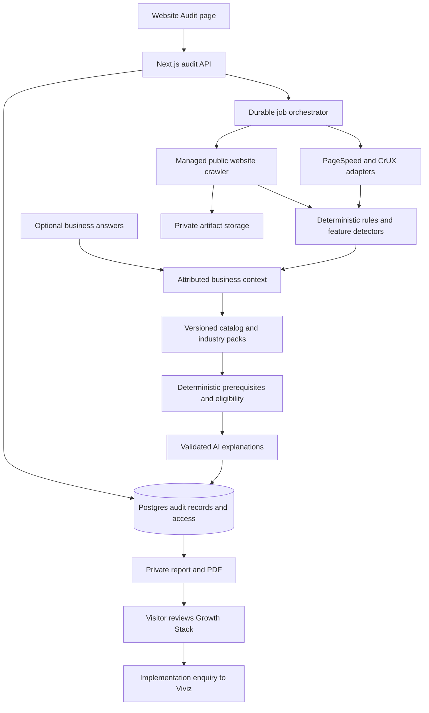

# Viviz Website Audit and GrowthOS Final Project Plan

Planning baseline version 2, prepared 24 October 2026. Incorporates the supplied [VIVIZ GrowthOS master specification](D:/Downloads/viviz_growthos_adaptive_codex_master.md) and the earlier website-audit plan. This is the consolidated plan for review before development.

Build a free website audit tool within the Viviz Technologies website. A visitor enters a public website URL, receives an evidence-backed assessment of problems and relevant enhancement opportunities, and can ask Viviz to implement selected improvements. The first release serves the confirmed business goal of generating qualified enquiries for Viviz.

The product should answer four questions: What is preventing visitors from completing their main task? Which useful capabilities were not observed on the checked pages? What does this business actually need, given its goals and existing tools? What should it improve first, and how can it verify the improvement?

## Relationship to GrowthOS

The first delivery is the **Website Audit and Adaptive Growth Planner**, embedded in the existing Viviz site. It acts as the assessment and acquisition layer for the longer-term GrowthOS vision. It produces a proposed Growth Stack and a reviewed implementation enquiry.

GrowthOS is the broader modular operating platform described in the master specification: tenant accounts, CMS, CRM, AI, communications, workflows, booking, industry modules and adaptive administration. Those operational capabilities form later deliveries with their own scope and estimates.

| Layer | Role | Delivery boundary |
| --- | --- | --- |
| Existing Viviz website | Explain services and packages; receive enquiries; retain current business tools | Preserve and add appropriate entry points |
| Website Audit | Measure and explain scoped public website issues | First release |
| Adaptive Growth Planner | Combine observations with optional business answers; recommend appropriate capabilities and sequence | First release |
| GrowthOS implementation | Configure or build agreed capabilities and connect existing business tools | Separately scoped client engagement |
| GrowthOS operating platform | Provide enabled modules, tenant permissions, integrations and business reporting | Future product stages |

The master file supplies product requirements and design ideas. Its execution block in section 59 and its platform-wide MVP in section 50 are reference material, rather than instructions to start development or replace the current audit scope.

## Inputs adopted from the master specification

| Master sections | Input | Final project decision |
| --- | --- | --- |
| 0 to 3 and 60 | Understand the business and assemble only useful capabilities | Make contextual recommendations the central product behavior |
| 7 to 9 | Business assessment, profile and industry taxonomy | Add optional, progressive discovery with attributed answers and unknown states |
| 5, 10 and 22 | Module catalog, industry packs and contracts | Create a small versioned recommendation registry; operational module SDK comes later |
| 6 and 11 to 14 | Rules, dependency resolution and AI explanations | Rules control eligibility and prerequisites; AI explains supported candidates |
| 12, 13, 16 and 43 | Recommendation levels, selection and Growth Stack | Let visitors include, reject or defer suggestions; selection creates no activation |
| 15 and 27 | Maturity-aware sequencing and growth opportunities | Use an evidence-based readiness profile and staged roadmap |
| 18, 19 and 38 | Adaptive interfaces and relevant KPIs | Tailor report sections; do not invent operational dashboards or business metrics |
| 26 and 37 | Continuous advice based on real performance | Later owner-authorized integrations and monitoring |
| 4, 23, 24, 39 to 42 and 48 | Platform core, tenancy, entitlements and billing | Required for the later platform, outside the anonymous free-audit release |
| 20, 21 and 49 to 57 | Suggested stack, monorepo and platform build stages | Preserve the current repository; evaluate separate backend/platform infrastructure when that product is commissioned |
| 53, 54 and 58 | Incremental delivery, tests and implementation tracking | Add staged acceptance gates and maintain a scoped implementation status document during development |

The source's example packs are candidate templates, not compulsory bundles. Its numerical example recommendations and maturity scores are illustrative, not validated prediction models. The source itself is not evidence that a feature is currently trending.

## Product direction

Working product name: **Viviz Website Audit**. Public entry route: `/website-audit`.

Suggested headline: **Find what is holding your website back.** Supporting copy: “Discover website issues, customer experience gaps, and useful features for your business.” Primary action: **Analyse website**.

Target users are small business owners, service companies, and marketing teams considering improvements to an existing website. The first specialist assessments will cover B2B/service businesses and local service businesses. Other website types receive general checks with their specialist coverage clearly identified.

The central value is the improvement roadmap and a tailored **Recommended Growth Stack**. Website scores alone are already available through products such as [HubSpot Website Grader](https://www.hubspot.com/tests) and [Semrush Site Audit](https://www.semrush.com/siteaudit/). Viviz can distinguish its product through business context, evidence, useful feature recommendations, recognition of existing tools, and a direct path to implementation. This is a positioning hypothesis to validate with prospective clients, rather than a claim that competitors lack these capabilities.

Do not require registration or an email address to view results online. Require a name and email before PDF download, and separately request contact details when a visitor asks for implementation help. A PDF download does not submit an enquiry or authorize marketing. Deliver the same findings regardless of whether the visitor becomes a lead.

## Launch scope

The product promise is a **multi-page public website audit with explicit coverage**. “Complete website audit” describes the long-term ambition; a single URL cannot provide access to every page, authenticated feature, or business process.

| Capability | First release |
| --- | --- |
| Website input | One public HTTP or HTTPS URL; accept a domain without a scheme and normalize it |
| Business context | Infer business type; allow the visitor to choose or correct it and specify an optional goal |
| Adaptive discovery | Optional short questions about the customer task, pain points and existing tools; no questionnaire gate |
| Page coverage | Up to 25 unique public HTML pages on the approved final origin |
| Page selection | Prioritize the entered page, homepage, important offering pages, contact, about, pricing and relevant support/policy pages |
| Audit breadth | Technical health, SEO, performance, automated accessibility, mobile observations, content/trust, conversion and feature opportunities |
| Performance sample | Homepage on mobile and desktop, plus up to two important pages on mobile; four PageSpeed runs maximum |
| Visual sample | Up to three important pages on mobile, plus the homepage on desktop; four screenshots maximum |
| Specialist analysis | B2B/service and local-service rulebooks; general analysis for other recognized types |
| Results | Private report, category summaries, top actions, evidence, feature inventory, coverage and a prerequisite-aware Growth Stack |
| Visitor decisions | Include in enquiry, not relevant, or consider later; choices remain separate from audit findings |
| Export | A concise downloadable PDF with scope, findings and evidence references, after required name/email capture |
| Lead capture | Visitor selects improvements and submits an implementation enquiry to Viviz |
| Language | English report interface; flag reduced content-analysis confidence when language support is insufficient |

These are proposed product limits, not provider defaults. Final time, byte, concurrency and spending limits will be calibrated during the technical proof of concept. A provisional ten-minute job deadline should produce a partial report when useful observations exist, rather than silently extending a scan.

Outside the first release: authenticated website areas, submitting forms or purchases, vulnerability exploitation, code changes to the target website, automatic implementation, subscriptions, customer accounts, scheduled monitoring, analytics connections and competitor benchmarking. No assessment should claim actual traffic, conversion rates, revenue loss, or a tested checkout without the necessary evidence.

## Progressive business discovery

Start collection as soon as the visitor submits a valid URL. During or after the scan, offer **Tailor my recommendations**. A visitor who skips it still receives the public website audit.

Keep the initial assessment to the following topics, with skip and unsure options. Ask follow-up questions only when they resolve a relevant recommendation.

| Topic | Information | Why it matters |
| --- | --- | --- |
| Business context | Editable industry/subtype; B2B, B2C or both; products, services or both | Match applicable rules without assuming every industry operates alike |
| Main customer task | Enquiry, appointment, demo, purchase, information or another task | Prioritize the journey the website should support |
| Goals | Up to three priorities such as enquiries, bookings, visibility, follow-up or support | Rank useful work |
| Pain points | Optional missed enquiries, repeated manual work, unclear offering, scheduling difficulty or repeated questions | Establish a reported problem rather than guessing it |
| Existing tools | Relevant CRM, scheduler, store, WhatsApp Business, email or analytics; whether the existing solution is adequate | Prefer repair, integration or clearer discovery before replacement |
| Operating readiness | Conditional questions about responsible staff, sales handoff, content or service availability | Avoid recommending a capability the business cannot maintain |

Examples of conditional questions are whether appointments are actually needed, whether the current CRM is working, and whether someone can manage a new communication channel. The master's full staffing, sales-cycle, software and operating-model questionnaire belongs in later assisted implementation onboarding.

Use a hierarchical, versioned taxonomy rather than a single fixed industry list. Keep industry separate from customer type and operating model: a manufacturer can be B2B and enquiry-led, while a local service business can also sell products. Allow multiple applicable rule groups and an unknown/custom category. Launch taxonomy and packs can be maintained as repository configuration; a taxonomy administration UI is a later platform feature.

## Business profile and evidence provenance

Keep three outputs distinct: **Website health** from public observations, **Business needs and readiness** from attributed answers, and **Recommended Growth Stack** from applicable rules and evidence.

Each business fact stores its value, source, source reference, timestamp, confidence and interpretation revision. Source types are `public_measurement`, `public_content`, `respondent_report`, `inference`, and later `authorized_integration`. Anonymous answers are respondent-reported and do not establish ownership of the website. Missing answers remain unknown, rather than false.

| Public collection can establish | Requires business answers or an authorized integration |
| --- | --- |
| A visible enquiry form, booking link, service description or published phone number | CRM use, actual missed leads, response times, team responsibilities or follow-up discipline |
| A tracking script or public product interface was observed | Correct analytics, marketing ROI, actual orders, retention or completed checkout |
| A company publishes a process or availability claim | Whether staff currently fulfil that promise |

Preserve disagreements between sources and display the relevant uncertainty. A visitor stating that a CRM exists can resolve an internal-tool question; it does not invalidate an observed broken link. Treat the source's after-hours enquiry percentages and traffic/conversion examples as future telemetry use cases, never as claims derived from a crawl.

Represent readiness qualitatively across relevant dimensions: website task clarity, enquiry handling, follow-up, measurement, integrations and capacity to operate the proposed change. Each dimension can be unknown, a foundation needed, an existing process, or a process supported by automation, with its basis shown. Avoid a numeric digital/automation maturity score at launch. A small business must not lose points for lacking irrelevant commerce, CRM or AI modules.

## Audit coverage

| Area | What the tool assesses | Interpretation |
| --- | --- | --- |
| Technical health | Responses for requested URLs, redirects, internal link destinations within the checked budget, crawl restrictions, sitemap discovery and URL duplication | Confirm HTTP facts; show unchecked links separately |
| Search foundations | Titles, descriptions, canonical directives, headings, internal linking, index directives and structured-data syntax/presence | Finding a directive does not prove Google indexing or eligibility for a rich result |
| Performance | Lighthouse diagnostics and scores for the declared sample; real-user Core Web Vitals where available | Keep laboratory and field measurements separate |
| Accessibility | Sampled Lighthouse accessibility checks and basic semantic checks across collected HTML | Automated assessment; untested interaction and manual checks remain visible |
| Mobile experience | Mobile measurement, viewport configuration, sampled screenshots and visible navigation or CTA concerns | Visual judgments are recommendations with confidence, not measured layout failures |
| Content and trust | Offering clarity, relevant decision information, visible company/contact details, policy and support routes, proof of experience | Presence/discoverability can be observed; authenticity usually requires review |
| Conversion path | Discoverable enquiry, booking, purchase or demo routes; visible form friction and unclear next steps | Review the public path without submitting or claiming funnel performance |
| Feature opportunities | Capabilities relevant to the business, customer task, existing alternatives and operational readiness | Optional ideas are separated from verified defects |

Performance uses PageSpeed Insights for lab results and a separate CrUX adapter for field data. Google recommends direct CrUX access because it plans to discontinue including CrUX field data in the PageSpeed API. Missing CrUX data means unavailable or insufficient data, rather than a performance failure. Preserve whether results describe a URL or an entire origin. See [PageSpeed API guidance](https://developers.google.com/speed/docs/insights/v5/get-started) and [CrUX methodology](https://developer.chrome.com/docs/crux/methodology).

Where field data exists, report LCP, INP and CLS with collection period, device and percentile. Current good thresholds are LCP at most 2.5 seconds, INP at most 200 milliseconds and CLS at most 0.1 at the 75th percentile. Never rename lab TBT as INP. See [Web Vitals](https://web.dev/articles/vitals).

An automated accessibility score must not be presented as WCAG compliance. Provide a manual-review list for keyboard operation, focus, screen-reader use, dynamic states and task completion. [W3C guidance](https://www.w3.org/WAI/test-evaluate/tools/selecting/) explains why tools require human evaluation.

## Analysis process

1. Validate the URL and reserve the scan quota. Establish permitted origin, public reachability and crawl policy. Treat changes between HTTP/HTTPS or www variants as explicit scope normalization; arbitrary external redirects require a new validated target.
2. Create a private audit record and enqueue durable work. Return immediately with a report location and job status.
3. Discover URLs through allowed sitemaps and internal links, then normalize duplicates and rank important pages. Discovery itself needs limits; discovered URLs are not automatically inspected pages.
4. Fetch the selected pages and retain the evidence required by each check. Include full navigation and footer information, rather than using cleaned main content as the only input.
5. Extract observed business context and page types. Use a visitor-supplied type or goal when present; show inferred assumptions in the report.
6. Run deterministic checks across available evidence. Run PageSpeed and screenshots on the declared representative sample.
7. Compare observed capabilities with applicable industry rules. Suppress irrelevant suggestions and identify incomplete evidence. Where visual review is enabled, a vision-capable adapter evaluates only the bounded screenshot sample, cites the image and visible region, and returns heuristic observations. A text-only model cannot perform this step; without vision or measured rendered checks, mark visual review unassessed and show screenshots for human inspection.
8. Combine attributed business context, deterministic rules, applicable industry packs and prerequisite resolution into a known set of eligible capabilities. Use an LLM to explain and organize these candidates and observations into an actionable roadmap. Validate its output against stored evidence and the allowed recommendation schema.
9. Store the report with coverage, failed checks, timestamps, analysis versions and suggested next actions. Preserve useful results when optional analysis fails.

Progress stages should follow recorded work: queued, discovering pages, checking pages, measuring sample pages, preparing recommendations, complete or partial. Counts should come from actual results. Cancellation stops new work and attempts provider cancellation; an already running external request may still finish.

Changing the business type, answers or goal after a report is ready creates a new interpretation revision from saved observations, subject to a small quota. Offer an explicit **Update recommendations** action rather than regenerating on every field change. It should not require an entire recrawl unless the new context needs additional pages. Preserve earlier choices for unchanged suggestions; clearly flag changed recommendations for review before an enquiry is sent.

## Capability catalog and industry packs

Use one controlled registry for recommendable capabilities and supporting requirements. A catalog entry is a recommendation contract; it does not imply an installed GrowthOS module or a prebuilt Viviz product.

The contract includes a stable code, name, category, version, business benefit, applicability conditions, detection signals, required evidence, existing alternatives, follow-up questions, exclusions, prerequisites, conflicts, operating needs, effort considerations, specialist coverage and source-review date. Add an explicit delivery state such as assessment-only, custom implementation subject to scoping, or verified available product. Public cards must not offer activation for planned capabilities.

Start with roughly 15 to 20 user-facing opportunities for the two supported business families: offering clarity, service enquiries, qualification questions, case studies, contact actions, service areas, visit information, appointment/demo requests, support information, CRM handoff, follow-up, conversion measurement, useful landing pages, language support, and a justified AI assistant. Include supporting prerequisite definitions where needed. General technical fixes can remain findings without being forced into commercial module recommendations.

Reuse canonical source codes where their meaning is clear. Normalize the master before implementation:

- Use `quotations`, treating `quotation` as an alias; define shared `appointments`, `reminders` and `product_catalog` once.
- Define missing references such as `whatsapp_automation`, `analytics` and `event_tracking`. Distinguish the notification foundation from optional delivery channels rather than silently equating `notifications` with one channel.
- Distinguish basic forms/media foundations from advanced form/media modules.
- Treat Website, CRM, Booking and Ecommerce as display groups over explicit capability codes.
- Define site visits as an appointment variant unless wider visit management warrants a separate module; avoid duplicate ambiguous codes.
- Separate this onboarding/growth advisor from later usage-based advice and from an e-commerce product recommendation engine. They do not share the same prerequisites.

Registry validation must reject unknown dependency references, duplicate codes, invalid versions and cycles. Maintain editable, versioned definitions in configuration for launch; database catalog administration, entitlements and tenant-module records belong to the operating platform.

Industry packs provide candidate rules, journeys and capabilities. B2B/professional services and local services receive specialist depth first. Real estate, education, manufacturing, healthcare, commerce and SaaS remain explicit expansion packs. A real estate consultancy without public inventory should not be pushed toward property listings, and a manufacturer taking custom RFQs should not be pushed toward checkout.

## Relevant features and current trends

The opportunity library is the user-facing set of entries in the same versioned capability registry, not a second independent catalog. Each entry contains the customer problem, applicable business/page types, required evidence, detection signals, existing alternatives, prerequisites, potential tradeoffs, source links, review date and expiry/review policy.

| Website type | Relevant capabilities to evaluate | Applicability example |
| --- | --- | --- |
| B2B/service | Service-specific enquiry, case studies, qualification questions, process explanation, consultation booking | An estimate calculator is useful only when the service can be estimated responsibly |
| Local service | Service areas, hours, click-to-call, directions, appointment or quote route | Appointment scheduling needs real availability and an operational owner |
| E-commerce | Product discovery, meaningful filters, product detail, delivery and return information | A small catalog may work well without elaborate filtering |
| SaaS | Clear demo/trial path, pricing or sales route, documentation and integration discovery | An interactive demo should support a genuine evaluation task |
| Publisher/content | Site search, authorship, related content, readable article navigation | Search becomes more relevant as the content collection grows |

The launch rulebooks specialize in the first two rows. General recommendations for other types must not imply a tested shopping, onboarding or publishing workflow.

Initial specialist rules should include the following evidence requirements. They describe opportunities when evidence supports them, rather than mandatory features for every site.

| Rule | Relevance and evidence required | Suppression or uncertainty |
| --- | --- | --- |
| B2B service-specific enquiry | Distinct services with different qualification needs; inspect service CTA destinations and the public enquiry form for relevant context | A suitable existing enquiry path satisfies the need; never infer successful delivery without testing |
| B2B proof of relevant work | Prospective clients need to evaluate expertise; inspect services, project/case-study pages and their discoverability | Other meaningful proof may suffice; do not judge the authenticity of claimed clients automatically |
| B2B evaluation guidance | An offering requires explanation; inspect scope, process and next-step information on relevant pages | Custom services may need a sales conversation rather than public pricing or a calculator |
| B2B consultation route | The business visibly offers consultations or demos; inspect homepage, service and contact links | An effective request form can satisfy the task without an embedded calendar |
| Local contact action | A business relies on phone enquiries; inspect published numbers and accessible telephone links | If the preferred route is email or booking, lack of click-to-call is not automatically a defect |
| Local service-area clarity | The business travels to customers; inspect service, location and contact content for coverage information | A public storefront address is not required for a service-area business |
| Local visit information | Customers visit a physical location; inspect address, hours and directions | Suppress for online-only or appointment-only operations where different information is appropriate |
| Local appointment route | Services are appointment-based; inspect service/contact pages and booking links | Recognize an external scheduler as present; emergency services may need immediate phone contact instead |

Each rule needs fixtures for present, partial, not observed, unknown and not-applicable states. Acceptance requires citing the checked locations, recognizing reasonable alternatives, and producing no recommendation when applicability is unsupported. Respondent answers can inform operational questions that public pages cannot answer, with their source and uncertainty preserved.

An AI assistant, WhatsApp automation, multilingual content, customer portal or personalization can be useful when it solves an observed need. Check content availability, support handoff, audience language, operating cost and maintenance before recommending it. The absence of fashionable technology never lowers website health.

Use the interface label **Feature opportunities**. A model's remembered knowledge is insufficient to label something currently trending. Later competitor comparison can report a dated observation such as “found on three of five comparable sites,” with URLs and sampling details. That observation establishes prevalence in a sample, not business benefit or a market-wide trend.

AI search readiness initially covers accessible text, clear structure, internal links and crawl access. Do not promise AI citations or treat a missing `llms.txt` file as a defect. Google's [AI search guidance](https://developers.google.com/search/docs/appearance/ai-features) says no special AI text files or schema are required for its AI features.

## Findings and recommendation quality

Keep four concepts separate: what was observed, confidence in that observation, severity of a defect, and implementation priority.

Feature states: **observed present**, **partial**, **not observed in scanned scope**, **unknown**, and **not applicable**. Failed fetches or missing rendering produce unknown observations, not missing-feature claims.

Each finding includes:

- A stable identifier, rule and rule version, category, and type: issue, opportunity or manual review.
- The business context and visitor task that make it applicable.
- Observation, checked URLs, affected count versus checked count, device and timestamp.
- Evidence such as a response status, metric, text excerpt, selector or screenshot reference, with its source tool/version.
- Severity where applicable, confidence with a short explanation, priority and approximate effort band.
- The recommended change, prerequisites, tradeoffs, and a concrete way to verify success.

Effort uses small, medium and large bands. Any suggested hours, cost or business benefit require further scoping. Repeated occurrences of one site-wide problem should be grouped into a single finding with affected pages.

Illustrative examples, not findings about an audited site:

| Type | Finding | Evidence and next step |
| --- | --- | --- |
| Verified issue | A navigation link returns 404 | Show source page and target response; repair the destination and verify it returns the intended page |
| Verified issue | A sampled contact field lacks a programmatic label | Show accessibility audit and selector; add a suitable label and verify with automated and manual checks |
| Opportunity | No appointment route was observed on the checked service and contact pages | Confirm whether visitors need appointments; consider booking only if the business can manage availability |
| Manual review | A demo request route exists but submission was not tested | Ask an authorized person to test delivery and confirmation before treating the funnel as functional |

The LLM receives only bounded, relevant observations and vetted opportunity rules. It cannot invent measurements, evidence URLs, competitor facts or return-on-investment claims. Invalid or unsupported claims are discarded. If AI analysis fails, return the deterministic findings and a templated action list.

## Hybrid recommendation and prerequisite engine

The recommendation pipeline is: attributed business context and observations, deterministic eligibility rules, industry-pack candidates, prerequisite and conflict evaluation, AI explanation, validated ranking, then visitor review. Rules remain authoritative; an LLM cannot create unknown module codes, override exclusions, change access, or approve costs.

Rules return a trace containing supporting observations or answers, applicability, candidate capability IDs, open questions and suppressions. Unknown inputs do not satisfy a condition requiring true or false. A reported pain point can support a conditional business recommendation without being rewritten as a measured website defect.

Model required prerequisites, alternative acceptable solutions, optional supporting capabilities, configuration requirements and incompatibilities separately. Support all-of and any-of requirements. Each prerequisite is satisfied, planned as earlier work, unresolved, or blocked. Recognize existing external tools as possible solutions; selecting one capability does not imply buying every supporting component from Viviz. Show dependent work and its implications for review, but do not automatically include explanatory prerequisites or deferred ideas in an enquiry.

For example, follow-up automation may require a reliable enquiry source, a responsible process, a suitable communication provider and valid contact/consent handling. A working existing CRM or scheduler may satisfy relevant needs. The appropriate recommendation may be to integrate or expose it better.

Do not copy overly rigid dependency examples from the master: guest checkout does not universally require customer accounts; a site visit does not universally require public property listings; lead qualification can use webhook/import intake as well as forms or assistants. Initial onboarding advice must work before usage analytics exists.

Recommendation levels are `essential`, `recommended`, `optional` and `not_needed_now`. Essential requires a supported task or operating requirement; industry membership alone is insufficient. Keep the four state dimensions separate:

| Dimension | States | Meaning |
| --- | --- | --- |
| Observation | Present, partial, not observed, unknown, not applicable | What the evidence says |
| Recommendation level | Essential, recommended, optional, not needed now | How relevant the proposed capability is |
| Visitor decision | Proposed, included, not relevant, consider later | What the visitor wants to discuss |
| Future operational state | Pending, configured, enabled, disabled, suspended | Whether a later deployed platform module operates |

Only the first three dimensions exist in the audit product. Buttons should say **Include in enquiry**, **Not relevant** and **Consider later**. Explain prerequisites and suggested sequence without automatic installation, connection, billing or activation. An accepted idea is not a purchase order or authorization for paid dependencies.

## Scoring and priority

Lead with the three most useful next actions and category summaries. Give the strongest two or three business-relevant feature opportunities their own prominent summary alongside fixes when evidence supports them; show fewer rather than manufacture suggestions. Each opportunity identifies the visitor task, current observed alternative, proposed capability, prerequisites and benefit hypothesis. Avoid an overall score at launch: technical measurements, subjective content judgments and optional features do not form one naturally comparable grade.

For categories with objective checks, publish a versioned formula: **100 multiplied by passed applicable rule weights, divided by assessed applicable rule weights**. A check is pass, fail, unknown or not applicable. Advisory observations do not affect that score. Normalize repeated instances within rules so a repeated footer problem does not overwhelm unrelated findings.

Show assessed weight versus applicable weight, pages/templates inspected and unknown checks beside the result. If less than 70 percent of the applicable rule weight has evidence, display **Limited assessment** instead of a numeric category score. This threshold is a proposed product policy to validate during the pilot. It does not imply 70 percent of the whole website was covered.

Keep original Lighthouse scores labelled by page, device, tool version and run date. Do not present one sampled score as the website's full performance or accessibility score. Content, conversion and feature opportunities use evidence and qualitative summaries until a defensible scoring model is established.

Order the roadmap by confirmed visitor blockers, other material defects, useful improvements with reasonable effort, and experiments requiring further validation. Within a tier, consider the declared business goal, affected important pages, confidence, implementation effort and dependencies. An urgent fix remains urgent even when it is difficult. Clearly separate estimated impact from measured impact.

## Page and report experience

Reuse the site's Inter typography, navy backgrounds, cyan primary accent, rounded panels and Lucide icons. Reserve purple for opportunities and green for verified passes; include text and icons with every status color. Use readable contrast and restrained motion.

The distinctive report elements are a **visitor task map** and **Your Growth Stack**. The map covers discovery, evaluation and contact/book/buy, with follow-up and retention shown only when supported by business answers or connected evidence. Place findings at the relevant stage and label inferred paths. A public path is not a completed transaction test.

The Growth Stack groups included improvements into fix first, improve next and consider later, showing the customer task, evidence or reported need, existing solution, proposed change, prerequisites and verification. It should explain which capabilities can be satisfied by existing systems, which need discovery and which require custom implementation.

Desktop landing structure:

```text
Shared Viviz navigation
Headline and short promise
Website URL [                             ] [Analyse website]
Optional business type and goal
Tailor my recommendations: short optional business assessment
Scope explanation and labelled sample report
What the audit checks | How recommendations are selected
Shared footer
```

Report structure:

```text
Website, business context, goal, date and scan coverage
Business facts: observed, reported and uncertain
Three recommended next actions
Strongest relevant feature opportunities
Visitor task map and category summaries
[Overview] [Website issues] [Growth Stack] [Pages and evidence] [Action plan]
Finding details: observation, evidence, action, confidence, effort, verification
Selected improvements -> Get implementation help
Download report
```

On desktop, use a wide report column and a compact selection/action sidebar. On mobile, stack content, allow URL wrapping, replace dense tables with cards, and collapse supporting evidence into accessible disclosures. Verify operation at 360 px, keyboard navigation, visible focus, labels, screen-reader announcements for progress and reduced motion.

Required states: untouched form, validating, queued/running, complete, partial, canceled, unreachable, robots restricted, provider unavailable, quota exceeded, expired report and invalid access. Preserve the URL and provide a meaningful next action after an error. Sample reports must remain labelled as examples.

## Integration with the existing site

The repository already has Next.js 16.2.11, React 19.2.4, TypeScript, Tailwind CSS 4, a shared Navbar/Footer, Postgres/Neon support, PDF rendering and Resend email. Build on these foundations.

Add Website Audit to the navigation and footer, plus small entry points on the homepage and Website Packages page. Recheck navigation breakpoints because the current desktop navigation is already crowded.

Use the existing ContactForm pattern for the implementation enquiry, extended with an audit service option and validated report context. Let the visitor review their selected findings/Growth Stack and enter name, email, optional phone and a message. Associate the report, exact assessment revision and selected recommendation snapshot server-side after checking access; do not trust client-provided findings or include complete scraped content in notification emails. Explain the purpose before sending supplied business answers to Viviz.

Map enquiries to web development, UI/UX, consulting, relevant automation or maintenance. Link to Website Packages when appropriate, but do not prescribe a rebuild or package solely from a score. A quotation still depends on scope and the target site's technology.

Update the entry page's metadata and sitemap. Exclude individual reports from the sitemap, add `noindex`/`noarchive` directives and enforce private access. Search directives are additional presentation controls, not access protection.

## Architecture and provider choices

Recommended launch architecture uses managed crawling/rendering and durable orchestration to minimize infrastructure work. Candidate defaults are Firecrawl for collection and Inngest for job orchestration, subject to the proof of concept and operating budget. Select one structured-output LLM provider behind an adapter. Reuse existing Postgres for structured results, quotas and ownership, and add private object storage for screenshots and large artifacts.



The Next application accepts work and serves progress/results; it does not keep a single request open for a whole-site scan. Inngest's [durable workflow guidance](https://www.inngest.com/docs/patterns/durable/run-long-jobs-on-serverless-hosts) supports splitting work into persistent, retryable steps. Each step still needs to finish within its runtime limit.

The proof of concept must verify that the crawler exposes sufficient original and rendered evidence, response status, navigation/footer content, timestamps, mobile screenshots, scoped discovery and failure details. Its [crawl](https://docs.firecrawl.dev/features/crawl) and [scrape](https://docs.firecrawl.dev/features/scrape) documentation describe relevant capabilities. Explicitly configure full content, TLS verification, freshness, robots handling and page limits rather than accepting unsuitable defaults. Do not depend on bypassing site restrictions.

If the managed provider cannot meet evidence or network-isolation requirements, use a separately deployed browser worker with outbound network enforcement. That adds infrastructure, maintenance and delivery time. More complete DOM geometry, axe checks, keyboard paths and controlled interaction testing belong in that worker; exclude unavailable checks from the managed MVP.

Follow the installed Next.js guides before implementation. Existing bundled guidance confirms async dynamic route params/cookies, Server Components by default and bounded `after()` execution. Neither `after()` nor increasing a route's timeout provides durable job processing. Keep audit reports dynamic and private; never put private results in shared page or CDN caches.

Keep scanning, business assessment, rules, dependency reasoning and provider access behind separate server-side services and validated contracts. Core contracts are BusinessContext, CapabilityObservation, ModuleDefinition, IndustryPack, RecommendationRule, ModuleSuggestion and AssessmentRevision. Use runtime validation for structured model inputs and outputs; supply bounded image evidence only to the visual adapter. Do not call an AI provider directly from a route handler; handlers validate and delegate to an orchestration/service layer. The master lists FastAPI/Pydantic/Redis as a platform option, but the audit can implement equivalent contract validation and background orchestration in the existing TypeScript app. A monorepo, ORM migration or Python service is not a prerequisite for the first release.

## Proposed modules and APIs

These are implementation destinations, not files created during planning.

| Destination | Responsibility |
| --- | --- |
| `app/website-audit/page.tsx` | Public landing page and URL submission |
| `app/website-audit/[id]/page.tsx` | Protected progress and report page |
| `components/website-audit/` | Input, progress, category summaries, finding cards, coverage and selection controls |
| `app/api/audits/route.ts` | Validate, reserve quota and create a scan |
| `app/api/audits/[id]/route.ts` | Protected status and report retrieval; deletion if requested |
| `app/api/audits/[id]/cancel/route.ts` | Cancel owned work |
| `app/api/audits/[id]/report/route.ts` | Protected PDF export |
| `app/api/audits/[id]/context/route.ts` | Correct business context and regenerate interpretation |
| `app/api/audits/[id]/assessment/route.ts` | Save optional attributed answers and create an assessment revision |
| `app/api/audits/[id]/recommendations/route.ts` | Retrieve or request bounded regeneration of the current Growth Stack |
| `app/api/audits/[id]/recommendations/[recommendationId]/decision/route.ts` | Include, defer or reject a suggestion for the current interpretation |
| `app/api/audits/[id]/enquiry/route.ts` | Submit reviewed implementation enquiry |
| `app/api/inngest/route.ts` | Signed job-runner integration if Inngest is selected |
| `lib/website-audit/` | Types, destination policy, repository, collection adapters, checks, rulebooks, prioritization and report generation |
| `lib/website-audit/jobs/` | Orchestrated collection, analysis, retries, expiry and cleanup steps |
| `lib/growth-planning/` | Business-context contracts, taxonomy, catalog, packs, rules, prerequisite evaluation and selection snapshots |
| `migrations/` | Versioned additive SQL migrations and rollback notes |
| `docs/IMPLEMENTATION_STATUS.md` | Scoped audit/planner milestone checklist maintained when development begins |

The context endpoint is a convenience update to the same versioned assessment service, not a second business-profile store. Module enable/disable, tenant configuration and platform entitlement endpoints from the master are future APIs; they are not exposed by this audit.

The create endpoint returns `202 Accepted`. Use an idempotency key to avoid duplicate scans on repeated submission. Enquiry submission also needs an idempotency key, a database uniqueness constraint and a transactional notification outbox; retries must not create duplicate leads or emails. Use provider idempotency where supported and reconcile uncertain notification outcomes. Poll progress approximately every three seconds while the tab is visible, with backoff; pause when hidden. Scope writes with same-origin protections and validate every request. Use parameterized database queries throughout.

Database additions: `audit_sessions` for anonymous ownership; `audit_scans` for context/status/budgets/coverage; `audit_pages` for page observations; `audit_findings` for grouped recommendations; `audit_artifacts` for private object references; `audit_events` for progress and failures; and `audit_usage` for atomic quotas. Associate selected findings with a minimal `audit_enquiries` record when submitted. Store versions of checks, rulebooks, prompts, model and providers for reproducibility.

Add versioned `audit_assessments`, `audit_business_facts`, `audit_capability_recommendations` and `audit_recommendation_decisions`, or equivalent normalized records, for attributed answers, known catalog references, decisions and recommendation snapshots. Store catalog/rule/pack versions and retain the exact enquiry snapshot so later context changes cannot alter what was submitted.

Each interpretation pins an evidence snapshot, assessment revision and catalog/rule/pack versions. Publish results only when that interpretation is still current, preventing an older slow job from replacing newer recommendations. Decision updates and enquiry submission carry expected interpretation and recommendation revision IDs; reject stale or withdrawn selections with a request to review current recommendations. Explicitly selected work and its approved snapshot remain stable across parallel tabs and regeneration.

Anonymous reports are session-owned, not tenants. Do not create a tenant, assume domain ownership, or attach an audit to a future customer merely because the URL matches. Later onboarding can explicitly import a minimized assessment snapshot after authentication, access checks and consent. The future platform must then apply tenant isolation to all tenant-owned data and jobs.

Use a reliable enqueue handoff: a transactionally recorded pending job plus idempotent dispatch/reconciliation, or an equivalent durable provider pattern. A database record without an accepted job must not remain indefinitely queued. Record per-step checkpoints, attempts and heartbeat; retry transient failures with bounded backoff and mark exhausted jobs partial or failed. Cancellation and expired job leases prevent new work from continuing indefinitely.

## Safe collection and private reports

Arbitrary URL fetching is a core engineering boundary for this product. Follow [OWASP SSRF prevention guidance](https://cheatsheetseries.owasp.org/cheatsheets/Server_Side_Request_Forgery_Prevention_Cheat_Sheet.html): validate schemes and destinations, reject credentials and unsupported ports, deny private/reserved IPv4 and IPv6 ranges, revalidate redirects and DNS resolution, and enforce egress restrictions on app-owned fetchers. Apply the policy to sitemaps, redirects, artifacts and browser subresources as well as the submitted URL. Provider-owned fetching needs equivalent verified protections.

Limit scope to the approved final origin. Inventory external links and external booking routes without recursively crawling them. Avoid login, logout, checkout actions, calendars, unbounded query combinations and file downloads. Permit only necessary public read requests and never submit business forms or click destructive actions. Robots policy and rate controls apply to all site collection, including standalone sample checks. Follow [RFC 9309](https://www.rfc-editor.org/rfc/rfc9309.html); do not circumvent access blocks or CAPTCHAs.

Proposed pilot quotas: three new scans per anonymous session per day, one active scan per session, one active scan per target origin, and supplementary IP-based throttling. All quotas are enforced centrally and atomically, with a global concurrent-job ceiling, per-job budgets and a daily spending circuit breaker. Domain cooldowns should be short enough that an attacker cannot cheaply reserve a business's website indefinitely. Tune shared-IP handling during the pilot.

Create an anonymous session through an opaque, high-entropy HttpOnly, Secure, SameSite cookie with a lifetime covering the 30-day report period; hash the server-side credential and associate it with scan ownership. A random report ID alone grants no access. Do not reuse invoice or employee authentication. Launch reports remain private to that browser; clearing cookies loses access, while cross-device recovery and explicit sharing can follow later. Describe this behavior before a visitor relies on a report link.

Treat crawled text as untrusted input. Do not execute its instructions, supply app credentials to the model, render raw third-party HTML, or expose unvalidated artifact URLs. Render sanitized excerpts and store screenshots privately. Verify job callbacks and use short-lived authorized artifact access. No public audit listing or index should exist.

Proposed retention under Viviz control: reports, assessment answers/revisions, structured findings and their minimized supporting excerpts or cited screenshots for 30 days; unreferenced screenshots and raw page bodies for up to seven days; and short-lived operational logs without scraped bodies, credentials or contact details. Avoid collecting sensitive records, credentials or customer datasets in the questionnaire. Regenerate interpretations and PDFs from retained observations, rather than depending on raw bodies after their expiry. Display evidence dates and report expiry. Verify and disclose each processor's own retention separately; request provider-side cleanup where supported.

Deletion or expiry first marks the scan inactive, revokes queued work and attempts provider cancellation. Every callback and worker write must check that state so late completion cannot recreate deleted findings or artifacts. Cleanup covers owned objects, derived reports and orphan artifacts, with retries for failed deletions. Provide deletion to the creator. Longer retention for a submitted lead needs a disclosed purpose and independent policy. Update the existing privacy notice to describe the audit, selected processors, retention and enquiry handling before launch.

## Lead generation and operating cost

Primary conversion: a visitor submits an enquiry for selected improvements. Secondary indicators: report completion, meaningful finding views and PDF downloads. Prefer aggregate first-party events that omit target URLs, extracted content and contact details.

Track the funnel from page visit to submission, useful report, selected improvements, submitted enquiry, qualified lead and eventual project. Track report usefulness separately from commercial success. Never inflate issue counts or recommend unnecessary work to increase leads.

Also review assessment completion/skip rates, changed recommendations after business answers, recognition of existing tools and the relevance of selected Growth Stacks. A longer questionnaire is justified only if it improves recommendation usefulness or lead qualification enough to offset abandonment. Keep the free audit separate from later GrowthOS platform/module pricing and scoped implementation quotations.

Operating cost per completed audit includes collection/rendering usage, PageSpeed or other API quota, LLM tokens, job execution, database/storage and export/email processing. Use the provider rate cards selected during development; do not assume the public tool can operate without infrastructure cost.

Keep the pilot within explicit page, screenshot, API call, token and retry budgets. Use bounded evidence summaries instead of passing all raw HTML to a model. Cache collection artifacts only when policy and freshness allow; label their observation time, keep private reports isolated and rerun material checks when stale. Avoid creating a new paid scan just to change report filters or business context.

Before public launch, measure cost and duration across at least 20 diverse sites, then calculate expected monthly cost from planned traffic. Compare scan spend against qualified lead yield rather than raw email collection. Establish the monthly budget and hard spending ceiling before enabling paid production services. Provider accounts and credentials are development setup tasks; none are provisioned by this plan.

## Delivery sequence

Estimated effort for the consolidated audit and adaptive planner is **16 to 23 working days for one developer**, approximately four to five working weeks, assuming timely provider access and no custom browser-worker requirement. This replaces the earlier 13 to 18-day audit-only estimate because the scope now includes progressive discovery, provenance, capability contracts, prerequisite reasoning and revision-aware selections. These are planning estimates rather than delivery commitments, and they exclude the later operating platform.

| Stage | Estimated effort | Reviewable outcome |
| --- | --- | --- |
| Technical proof of concept | 2 to 3 days | Validate collection fidelity, public destination controls, JavaScript rendering, sample measurement, provider limits and unit costs on at least five sites |
| Durable audit foundation | 3 to 4 days | Additive schema, anonymous ownership, quotas, reliable job creation, bounded crawl, evidence storage and real progress |
| Adaptive assessment and contracts | 3 to 5 days | Optional discovery, attributed business facts, taxonomy, canonical catalog, two industry packs and validated prerequisite rules |
| Audit and recommendation engine | 3 to 4 days | Versioned checks, traceable eligibility, validated AI explanations, partial results, readiness and prioritized Growth Stack |
| Page and business integration | 3 to 4 days | Branded landing/report experience, mobile states, decision controls, PDF, revision-aware implementation enquiry and navigation links |
| Pilot and launch hardening | 2 to 3 days | Representative-site review, access/isolation tests, budget verification, privacy updates, operational checks and launch configuration |

Each stage produces something inspectable. A UI mock with sample data can establish layout, but the shipped flow requires real collection and evidence. After the proof of concept, revise scope or estimate if provider limitations require a dedicated worker.

## Validation and launch criteria

Use focused tests for the audit engine's consequential behavior: URL/network-policy cases, robots/scope rules, deduplication, scoring with unknown checks, evidence validation, ownership, idempotency and quota races. Add integration tests with recorded provider fixtures for timeout, duplicate webhook/event delivery, partial crawl, unavailable CrUX, AI failure, cancellation and worker restart. Test actual collection only against permitted representative sites and controlled fixtures.

Test the adaptive planner for missing versus false inputs, evidence/answer provenance, duplicate or unknown capability codes, dependency cycles/conflicts, alternative prerequisites, industry exceptions, existing external tools, invalid AI output and stable enquiry snapshots after reassessment. Test that selection never performs activation or billing and that a visitor cannot alter another session's assessment or decisions.

End-to-end checks cover URL submission through real progress to report, evidence expansion, context correction, PDF export, deletion and reviewed enquiry submission. Verify that another session cannot read reports, PDFs or artifacts, and that existing invoice, employee, contact and payment flows retain their behavior. Run the repository's lint and production-build checks during development, plus targeted browser checks for mobile and keyboard use.

Launch requires:

- Every reported defect has supporting evidence and an observation scope; every opportunity has a stated business rationale.
- No internal business fact is presented as discovered from a public URL; respondent statements and inferences remain attributed.
- Every suggested capability uses a registered code and applicable rule. Prerequisites are satisfied, explicitly planned as earlier work, unresolved, or blocked, with the consequence visible. Existing adequate tools suppress duplicate replacement recommendations. Only reviewed, explicitly included suggestions enter an enquiry.
- The two supported business families produce meaningfully different recommendations, while unsupported specialist depth is labelled.
- Unknown operational readiness is visible, not a low maturity score; including or deferring a suggestion does not alter factual findings.
- Unknown and unassessed states never become failures or missing-feature claims.
- A 25-page cap, sample limits, quotas, retries and spending circuit breaker remain enforced under concurrency and failure.
- Jobs recover from retryable failures without duplicated scans or enquiries; stalled work reaches a visible terminal state.
- Partial reports remain usable when an optional measurement or AI step fails.
- Report, PDF and artifact access requires ownership; report pages are excluded from indexing and public caches.
- The free report is usable before contact capture; lead submission is a deliberate visitor action.
- A pilot of at least 20 varied sites includes JavaScript-heavy, blocked, small local-service, B2B, larger catalog and non-English examples. Human review checks the most important recommendations on every pilot report, with no unsupported critical claims accepted.
- Cost, completion rate, duration, false-positive rate and recommendation usefulness are recorded. Set numerical launch targets after the proof of concept rather than inventing guarantees now.

Operational controls should include an audit-only kill switch, visible job failure/cost alerts and a rollback that preserves the existing website and finance/HR data. Launch through a limited pilot before promoting the tool across the site.

## Adaptive demonstration scenarios

Use the master's demonstrations as contextual tests rather than fixed installation lists. Only the two launch packs are marketed as specialist assessments; other examples validate suppression and general fallback behavior until specialist coverage is developed.

| Scenario | Expected behavior |
| --- | --- |
| Viviz-like IT service business with adequate enquiry routes | Assess service clarity and evidence of work; do not automatically prescribe AI, WhatsApp or workflow automation |
| Small service business with no appointment requirement | Suppress booking and enterprise pipeline recommendations |
| Same site with a respondent reporting missed enquiries across three staff | Add a conditional lead-handling opportunity citing the answer, not a newly measured website defect |
| Same respondent confirms a working external CRM | Prefer integration or process improvement and suppress duplicate CRM replacement |
| Appointment-led local business already using an external scheduler | Recognize the route; recommend clearer discovery or configuration only where evidence supports it |
| Real estate consultancy without published inventory | Avoid compulsory property-listing prerequisites and label specialist coverage limitations |
| Store using guest checkout | Do not report absent customer accounts as a universal defect or prerequisite |
| Visitor supplies no business answers | Return the public audit with operational readiness unknown |
| Business context changes or a suggestion is deferred | Reinterpret retained evidence, retain consistent choices and require review of changed suggestions |
| Visitor includes a module in the Growth Stack | Capture a reviewed enquiry; no module installation, external connection or charge occurs |

## GrowthOS expansion roadmap

Build the later operating platform in separately reviewed stages, following the master's architectural dependencies:

| Later stage | Scope | Exit gate |
| --- | --- | --- |
| Viviz operations pilot | Optional internal assessment/enquiry workspace and implementation handoff | Authorized staff access, reliable enquiry lifecycle and clear data separation from finance/HR |
| Platform core and module framework | Tenant identity, users, RBAC, core services, module contracts, dependency engine, configuration versions, entitlements and audit logs | Two isolated test tenants; disabled module APIs denied; permissions and enabled modules drive navigation |
| First operational module set | Basic CMS/forms/leads/tasks and only the agreed communication or booking capabilities | Two different business profiles operate different module combinations successfully |
| Advanced modules and industry packs | Scoped CRM pipeline, quotations, RAG/assistant, workflows, WhatsApp, booking and selected industry operations | Each module has tested configuration, operational ownership, access boundaries and measured usefulness |
| Adaptive performance and commercial platform | Authorized telemetry, module-aware dashboards, monitoring, plans, usage limits, billing and custom domains | Metrics have real sources; tenant isolation covers DB, cache, jobs, storage, retrieval and integrations; paid changes require explicit authorization |

Before multiple customers use the platform, require authenticated tenant resolution, permission and entitlement enforcement on backend routes, encrypted integration credentials, safe dependency activation/deactivation, versioned configuration migrations and recovery from interrupted onboarding. AI tools and retrieval must respect enabled modules and tenant scope. Hiding navigation alone is insufficient.

Choose a monorepo and any FastAPI/Postgres/Redis worker stack for that later product based on deployment and team needs. Preserve portable assessment/catalog contracts from the first release without committing this website to a premature rewrite. The source's larger platform MVP needs a fresh estimate and cannot be included in the audit/planner delivery schedule.

## Later audit capabilities

After the first release demonstrates useful recommendations and qualified leads, consider deeper verified scans, specialist e-commerce/SaaS rulebooks, explicit competitor comparison, customer accounts and cross-device history. A browser worker can add geometry, axe, keyboard testing and carefully authorized interactions. Owner-approved Search Console and analytics connections can supply indexing, traffic and conversion evidence.

Scheduled monitoring, before/after comparisons, team workspaces, paid agency reports and implementation integrations should follow demonstrated demand. Measure improvements using the same scope and rule versions where possible. Neither this first release nor later phases should automatically modify a target website without a separately authorized implementation workflow.

## Scope decisions for development

Confirmed: a free tool embedded in the existing Viviz site, primarily generating implementation leads, informed by the supplied adaptive GrowthOS vision. Final planning defaults: `/website-audit`, no account or email gate, 25 public pages, optional progressive discovery, attributed business facts, two specialist packs, a controlled capability catalog, deterministic prerequisite reasoning, private browser-owned reports, evidence-based category summaries, a selected Growth Stack, PDF export and reviewed implementation enquiries.

Development setup must establish provider access, a monthly operating budget, private artifact storage and reliable background execution. The proof of concept resolves collection fidelity and the final managed-provider choice. Branding can use the existing site without delaying the core workflow.

This planning deliverable adds documentation only. Application pages, APIs, dependencies, database schema and deployment remain unchanged until development is requested.
